# ER Diagram

Auto-generated by `lsdb erdiagram` on 2026-11-06T00:29:41.021Z. Re-run after schema changes to refresh.

## Tables by actor

- **admin**: bookings, contact_messages, couple_members, couples, credentials, schema_versions, section_components, site_templates, stats, themes, users, vendor_categories, vendors
- **couple**: budget_categories, checklist_items, couple_profile, guest_photos, guest_wishes, guests, milestones, website_assets, website_sections
- **vendor**: portfolio_items, services, vendor_profile

## Diagram

```mermaid
erDiagram
    bookings {
        string booking_id UK
        string couple_id FK
        string vendor_id FK
        string service_summary
        date event_date
        number amount
        string status
        string notes
        date _created_at
        date _updated_at
        string _id PK
    }
    contact_messages {
        string message_id UK
        string name
        string email
        string subject
        string message
        string status
        date _created_at
        date _updated_at
        string _id PK
    }
    couple_members {
        string member_id UK
        string couple_id FK
        string user_id FK
        string member_role
        string invited_by FK
        date joined_at
        date _created_at
        date _updated_at
        string _id PK
    }
    couples {
        string couple_id UK
        string actor_sheet_id UK
        string partner1_name
        string partner1_email
        string partner2_name
        string partner2_email
        string slug UK
        string custom_domain UK
        date wedding_date
        string status
        string website_status
        date _created_at
        date _updated_at
        string _id PK
    }
    credentials {
        string user_id
        string password_hash
        string provider
        string _id PK
    }
    schema_versions {
        string schema_version_id PK
        string actor_sheet_id
        string table_name
        string schema_hash
        string synced_at
        number column_count
        string _id UK
    }
    section_components {
        string component_id UK
        string section
        string name
        string preview_bg_color
        string preview_text_color
        string preview_accent_color
        string font_style
        string status
        date _created_at
        date _updated_at
        string _id PK
    }
    site_templates {
        string template_id UK
        string name
        string slug UK
        string description
        json default_theme
        json default_components
        json default_sections
        string status
        date _created_at
        date _updated_at
        string _id PK
    }
    stats {
        string stat_id UK
        string label
        string value
        string icon
        number display_order
        boolean active
        date _created_at
        date _updated_at
        string _id PK
    }
    themes {
        string theme_id UK
        string name
        string description
        json tokens
        boolean is_active_web
        boolean is_active_couple
        string status
        date _created_at
        date _updated_at
        string _id PK
    }
    users {
        string user_id UK
        string role
        string email UK
        string actor_sheet_id
        string status
        date _created_at
        date _updated_at
        string _id PK
    }
    vendor_categories {
        string category_id UK
        string key UK
        string label_en
        string label_kh
        string icon
        boolean active
        date _created_at
        date _updated_at
        string _id PK
    }
    vendors {
        string vendor_id UK
        string actor_sheet_id UK
        string business_name
        string owner_email
        string category_id FK
        string location
        string description
        string status
        date submitted_at
        date approved_at
        string approved_by FK
        date _created_at
        date _updated_at
        string _id PK
    }
    budget_categories {
        string category_id UK
        string name
        number allocated
        number spent
        string color
        date _created_at
        date _updated_at
        string _id PK
    }
    checklist_items {
        string item_id UK
        string text
        boolean completed
        string category FK
        number budget_allocated
        number budget_spent
        date due_date
        string priority
        string notes
        date _created_at
        date _updated_at
        string _id PK
    }
    guest_photos {
        string photo_id UK
        string storage_key
        string url
        string uploader_name
        string uploader_token
        string mime_type
        number size_bytes
        string status
        date _created_at
        date _updated_at
        string _id PK
    }
    guest_wishes {
        string wish_id UK
        string name
        string message
        string photo_id
        string uploader_token
        string status
        number gift_amount
        string gift_currency
        date _created_at
        date _updated_at
        string _id PK
    }
    guests {
        string guest_id UK
        string name
        string telegram
        string phone
        string status
        boolean plus_one
        string plus_one_name
        date invited_date
        date confirmed_date
        string group
        string notes
        string gift_status
        string gift_type
        number gift_amount
        string gift_currency
        date gift_received_date
        string gift_note
        date _created_at
        date _updated_at
        string _id PK
    }
    milestones {
        string milestone_id UK
        string title
        string task
        number months_before
        boolean completed
        date _created_at
        date _updated_at
        string _id PK
    }
    couple_profile {
        string profile_id UK
        string love_story
        string cover_photo_url
        string ceremony_time
        string ceremony_venue
        string ceremony_address
        string reception_time
        string reception_venue
        string reception_address
        string dress_code
        string site_template_id
        json theme_override
        string photo_uploads
        number photo_max_per_guest
        number photo_max_size_mb
        number photo_rate_per_ip_per_hour
        date _created_at
        date _updated_at
        string _id PK
    }
    website_assets {
        string asset_id UK
        string couple_id
        string storage_key
        string url
        string mime
        number size_bytes
        number width
        number height
        date _created_at
        date _updated_at
        string _id PK
    }
    website_sections {
        string section_id UK
        string section_key
        string component_id
        json color_override
        number display_order
        boolean enabled
        json content
        date _created_at
        date _updated_at
        string _id PK
    }
    portfolio_items {
        string item_id UK
        string image_url
        string caption
        number display_order
        date _created_at
        date _updated_at
        string _id PK
    }
    vendor_profile {
        string profile_id UK
        string bio
        string service_area
        date _created_at
        date _updated_at
        string _id PK
    }
    services {
        string service_id UK
        string name
        string description
        number price
        string unit
        date _created_at
        date _updated_at
        string _id PK
    }

    couples ||--o{ bookings : "couple_id"
    vendors ||--o{ bookings : "vendor_id"
    couples ||--o{ couple_members : "couple_id"
    users ||--o{ couple_members : "user_id"
    users ||--o{ couple_members : "invited_by"
    vendor_categories ||--o{ vendors : "category_id"
    users ||--o{ vendors : "approved_by"
    budget_categories ||--o{ checklist_items : "category"
```

